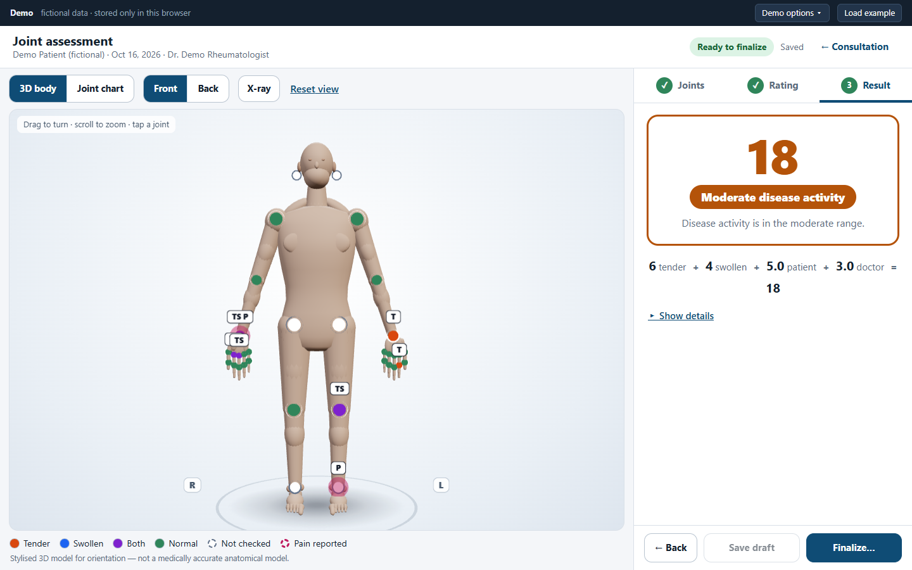
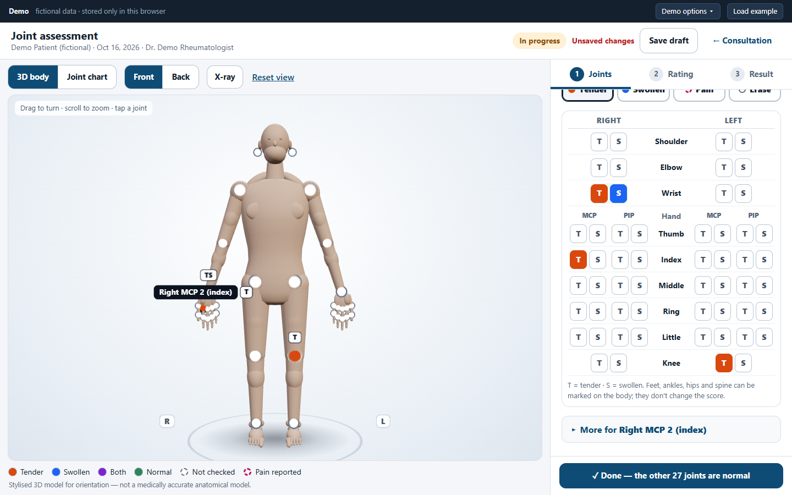
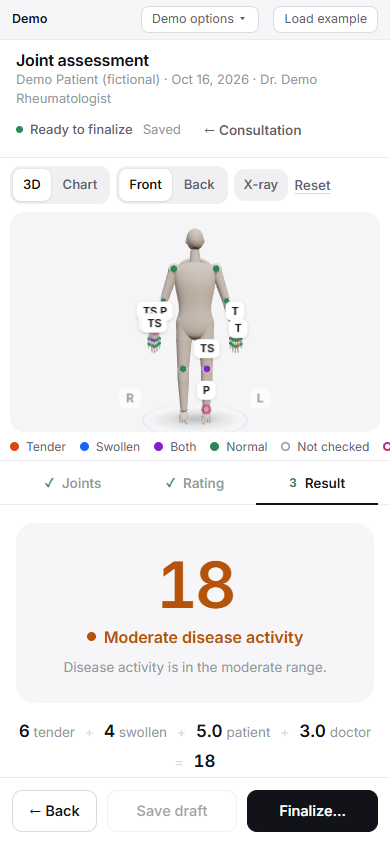
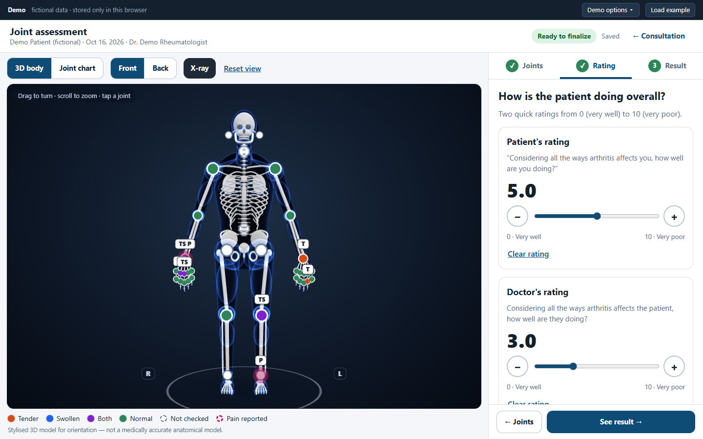

# Joint assessment — 3D rheumatology exam & CDAI

A simple, guided **joint examination and Clinical Disease Activity Index (CDAI)** module for rheumatoid
arthritis, built to be opened from an existing consultation.

**Live demo:** https://pruthviraj05.github.io/rheumatology-cdai-assessment/ · fictional data, stored only in your browser.
Click **Load example** to see 6 tender + 4 swollen + 5 patient + 3 doctor = **CDAI 18, moderate**.



## How it works — three simple steps

1. **Joints** — tap only the joints that are **tender or swollen**, either on the 28-joint form (T / S buttons,
   laid out like the paper form) or directly on the body. Then one button — *"Done — the other N joints are
   normal"* — records every joint you didn't mark. A typical patient takes a handful of taps, not 56.
   Pain, "can't be assessed" and notes are under *More* for the last joint you touched. Undo is always available.
2. **Rating** — the patient's and the doctor's rating on a 0–10 slider ("Not rated yet" is never treated as 0).
   Counts can also be typed directly, like on MDCalc.
3. **Result** — the CDAI appears only when everything is entered; otherwise it tells you exactly what's missing.
   Save a draft or finalize; finalized results can be amended with a reason (the original is kept).

| Desktop — guided joint check | Phone |
|---|---|
|  |  |



## The calculation

`CDAI = tender joints (0–28) + swollen joints (0–28) + patient rating (0–10) + doctor rating (0–10)` → 0–76.
Remission ≤ 2.8 · Low > 2.8–10 · Moderate > 10–22 · High > 22.

* Only the standard 28 joints count (shoulders, elbows, wrists, MCP 1–5, PIP 1–5 incl. thumb IP, knees).
  Feet, ankles, hips, DIP, jaw and spine can be documented but never change the score.
* Arithmetic is done in integer tenths, so 0.1 + 2.7 is exactly 2.8 (remission) — a classic floating-point trap.
* Verified against the official [MDCalc calculator](https://www.mdcalc.com/calc/2177/clinical-disease-activity-index-cdai-rheumatoid-arthritis)
  at every category boundary — in unit tests **and** by entering the cases through the real UI in the E2E suite.

## 3D body

* Stylised anatomical model built procedurally: lofted torso, shaped head, muscle-shaped limbs, detailed hands
  (knuckles, three phalanges per finger, nails, thenar eminence) and feet (heel, arch, toes, ankle bones).
* **X-ray** toggle gives a radiograph-style view on a dark background: glowing soft-tissue outline and a skeleton —
  skull with orbits, teeth and mandible, S-curved spine (24 vertebrae with discs and processes), 12 curved rib
  pairs with costal cartilage and sternum, clavicles, scapulae, pelvis, long bones with epiphyses, carpals,
  metacarpals, phalanges, patellae, tarsals and metatarsals — aligned with the joint markers.
* Optimised: render-on-demand, the whole body is one draw call, all 54 markers are 4 instanced draw calls
  (**6 draw calls total**, ~59k triangles), size-based level of detail, adaptive resolution while orbiting.
* A **Joint chart** (2D) offers the identical workflow and is used automatically when WebGL isn't available.
* It is a stylised model for orientation, not a medically accurate anatomical asset.

## Run it

```bash
npm install
npm run dev          # http://localhost:5173
npm run check        # typecheck + lint + 88 unit/component tests
npm run build
npm run e2e          # 44 real-browser checks (needs a running dev/preview server and local Chrome)
npm run e2e:perf     # draw calls, frame pacing, pick-through check
npm run deploy       # publish dist/ to GitHub Pages
```

## Integrating into the clinic application

```tsx
<RheumatologyAssessmentModule
  context={{
    patient: { id: patient.id, name: patient.name },
    consultation: { id: consultation.id, date: consultation.date },   // yyyy-mm-dd
    clinician: { id: user.id, name: user.name },
    permissions: { canView: true, canEdit: user.can('rheum.assess') },
  }}
  repository={clinicApiRepository}          // implements AssessmentRepository
  onReturnToConsultation={() => navigate(`/consultations/${consultation.id}`)}
/>
```

`AssessmentRepository` (`src/persistence/repository.ts`) has three methods. Run the same pure `applySave()`
(`src/domain/records.ts`) on the server so validation, finalization and history never depend on the browser.

## Layout

```
src/domain       pure clinical logic: CDAI engine, joint registry, findings/counting, save lifecycle
src/persistence  repository interface + localStorage / in-memory adapters
src/scene        anatomy.ts (procedural geometry) + Body3D.tsx (scene, instanced markers, camera)
src/ui           3-step module (steps/), body stage, 2D chart, session hook
src/host         demo host standing in for the clinic app
e2e/             Playwright flows (functional, calculations, responsive, perf)
docs/            PLAN.md, CLINICAL_NOTES.md, screenshots
```

See [docs/CLINICAL_NOTES.md](docs/CLINICAL_NOTES.md) for decisions that need rheumatologist sign-off.
