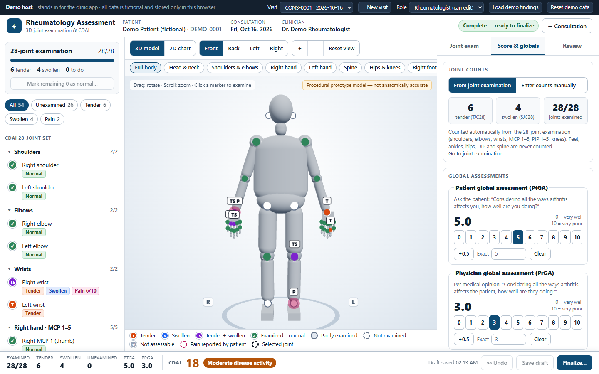

# Rheumatology Assessment — 3D joint examination & CDAI

An interactive **3D joint examination and Clinical Disease Activity Index (CDAI)** module for rheumatoid
arthritis, built to be mounted from an existing consultation screen.

**Live demo:** https://pruthviraj05.github.io/rheumatology-cdai-assessment/ &nbsp;·&nbsp; all data is fictional and stays in your browser.



## What it does

* **Interactive 3D body** (rotate / zoom / pan, front-back-left-right, jump to hands, feet, spine…) with a
  full-featured **2D chart** fallback that supports the identical workflow (also used automatically when WebGL
  is unavailable).
* **Three independent concepts per joint** — patient-reported pain (+ optional 0–10), clinician-assessed
  tenderness, clinician-assessed swelling. "Not examined" is never treated as negative.
* **Exact CDAI** — `TJC28 + SJC28 + PtGA + PrGA`, range 0–76, ≤2.8 remission / >2.8–10 low / >10–22 moderate / >22 high.
  Verified against the official [MDCalc calculator](https://www.mdcalc.com/calc/2177/clinical-disease-activity-index-cdai-rheumatoid-arthritis).
* **Strict 28-joint set** — shoulders, elbows, wrists, MCP 1–5, PIP 1–5 (thumb IP = PIP 1), knees. Feet, ankles,
  hips, DIP, TMJ and spine are pain-map only and never counted.
* **Fast examination flow** — no per-joint dialogs; keyboard shortcuts (`T` `S` `P` `N` `←` `→` `Ctrl+Z`),
  "Normal & next", guided next-unexamined, filters, undo.
* **Two ways to get counts** — from the joint examination, or typed manually (MDCalc-style).
* **Global assessments** with a proper "not set" state (never defaults to 0), 0.5 steps + exact entry, validation.
* **Save lifecycle** — draft → finalized → amended (reason required, previous version retained), history table
  and trend, double-save protection, failed saves never lose entries, read-only role.
* Responsive: desktop 3-panel workstation, tablet, phone.

> The 3D body is a **procedural prototype** (clearly labelled in the UI), not anatomically accurate. This tool
> records and calculates; it does not diagnose or recommend treatment. See
> [docs/CLINICAL_NOTES.md](docs/CLINICAL_NOTES.md) for the decisions that need rheumatologist sign-off.

## Run it

```bash
npm install
npm run dev          # http://localhost:5173
npm run check        # typecheck + lint + 70+ tests
npm run build        # production bundle in dist/
npm run e2e          # real-browser end-to-end flow (needs the dev/preview server + local Chrome)
```

Try it: click **Load demo findings** in the host bar → TJC 6 + SJC 4 + PtGA 5 + PrGA 3 = **CDAI 18, moderate**.

## Integrating into the clinic application

The module takes references to *existing* patient / consultation / clinician records and a persistence adapter —
it never creates patients, consultations or users.

```tsx
import RheumatologyAssessmentModule from './ui/RheumatologyAssessmentModule'

<RheumatologyAssessmentModule
  context={{
    patient: { id: patient.id, name: patient.name },
    consultation: { id: consultation.id, date: consultation.date },   // yyyy-mm-dd
    clinician: { id: user.id, name: user.name },
    permissions: { canView: true, canEdit: user.can('rheum.assess') },
  }}
  repository={clinicApiRepository}          // implements AssessmentRepository
  onReturnToConsultation={() => navigate(`/consultations/${consultation.id}`)}
/>
```

`AssessmentRepository` (`src/persistence/repository.ts`) has three methods — `getForConsultation`,
`listForPatient`, `save`. On the server run the same pure `applySave()` (`src/domain/records.ts`) so validation,
finalization rules and revision history never depend on the browser, and write to the existing audit log.

## Project layout

```
src/domain       pure clinical logic (cdai, joint registry, findings/counting, records & lifecycle)
src/persistence  repository interface + localStorage / in-memory adapters
src/scene        react-three-fiber body, markers, camera rig (lazy-loaded chunk)
src/ui           module shell, navigator, joint editor, score, review/history, 2D chart
src/host         demo host standing in for the clinic app
e2e/             Playwright (driving local Chrome) flow / perf / picking probes
docs/            PLAN.md, CLINICAL_NOTES.md, screenshots
```

## 3D performance notes

Render-on-demand frame loop, the whole body merged into one vertex-coloured geometry (≈74 draw calls total),
shared marker geometry/materials, memoised markers, adaptive DPR while interacting, damped controls with
exponential camera easing, DOM label layer (no in-canvas portals). ~48 fps even under *software* WebGL in CI.

## Deploy

`npm run deploy` builds and publishes `dist/` to the `gh-pages` branch (GitHub Pages, relative base path).
